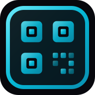

<div align="center">



# QRVault

**Free custom QR code generator — 100% private, in your browser.**

[](https://qrvault.app)
[](#license)

<br />

Your data **never leaves your device**. QRVault runs entirely client-side — no uploads, no servers, no tracking. URLs, WiFi passwords, and email addresses stay on your machine.

</div>

---

## Features

- **Four content types** — URL, plain text, email (pre-filled address, subject, body), WiFi (SSID, password, security type — scan to connect on iOS & Android)
- **Custom dot styles** — multiple shape options for the QR pattern and corners
- **Color picker** — foreground and background colors
- **Logo embed** — upload a PNG/SVG logo (≤ 200 KB) into the center of the code
- **Error correction** — four levels (L / M / Q / H); use H when embedding a logo to ensure scannability
- **Download formats** — PNG, SVG, JPG
- **Offline-capable** — works with no internet connection after the page loads
- **Internationalization** — English, Português (BR), Español, Français, Polski
- **Dark theme** — sleek cyan-accented UI with smooth Framer Motion animations

## Tech Stack

| Layer | Technology |
|---|---|
| Framework | React 19 + TypeScript |
| Build | Vite 8 |
| Styling | Tailwind CSS 4 |
| UI primitives | Radix UI |
| Animation | Framer Motion |
| QR engine | qr-code-styling |
| i18n | i18next + react-i18next (5 locales) |
| Icons | lucide-react |
| Linting | Biome |
| Testing | Vitest + Testing Library |
| Hosting | Vercel |

## Getting Started

### Prerequisites

- **Node.js** ≥ 18
- **npm** ≥ 9 (or your preferred package manager)

### Install & Run

```bash
# Install dependencies
npm install

# Start the dev server (http://localhost:5173)
npm run dev
```

### Available Scripts

| Command | Description |
|---|---|
| `npm run dev` | Start Vite dev server with HMR |
| `npm run build` | Type-check + production build |
| `npm run preview` | Preview the production build locally |
| `npm run lint` | Lint with Biome |
| `npm run lint:fix` | Auto-fix lint issues |
| `npm run format` | Format source files |
| `npm run test` | Run tests in watch mode |
| `npm run test:run` | Run tests once |
| `npm run test:coverage` | Generate coverage report |

## Project Structure

```
qrvault/
├── public/              # Static assets (favicon, icons, robots.txt, sitemap)
├── src/
│   ├── components/      # React components (QRPreview, CustomizationPanel, DownloadPanel, etc.)
│   ├── hooks/           # Custom React hooks
│   ├── i18n/            # i18n config & locale files (en, pt-BR, es, fr, pl)
│   ├── lib/             # QR content encoders, constants & utilities
│   ├── types/           # TypeScript type definitions
│   ├── __tests__/       # Unit & component tests
│   ├── App.tsx          # Root application component
│   └── main.tsx         # Entry point
├── api/                 # Vercel serverless functions
├── index.html           # HTML shell with SEO + Open Graph meta
├── vite.config.ts
├── tsconfig.json
└── biome.json
```

## How It Works

1. **Choose a content type** — URL, text, email, or WiFi.
2. **Fill in your content** — the QR code updates live as you type (debounced 300 ms).
3. **Customize** — pick dot styles, corner shapes, colors, and optionally embed your logo.
4. **Set error correction** — use level H when adding a logo so the code still scans.
5. **Download** — export as PNG, SVG, or JPG.

All processing runs inside the browser via `qr-code-styling`. One `QRCodeStyling` instance is created per session and updated in place — no round trips, no server calls.

## Privacy

QRVault was built around a single principle: **what you type is yours**.

- Zero network requests for content data — everything stays in the browser sandbox
- No analytics, no cookies, no third-party trackers
- Session-only state — nothing is persisted to disk or any external service

## License

© ROC Desenvolvimento de Software Ltda. All rights reserved.
